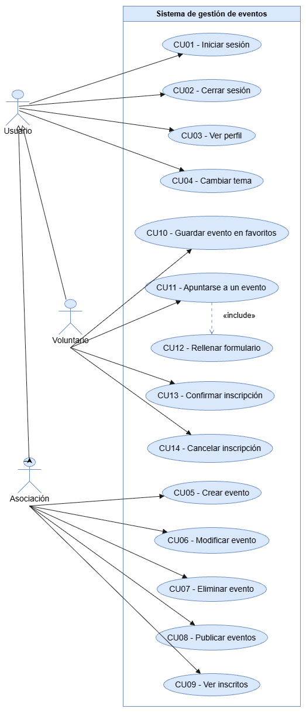
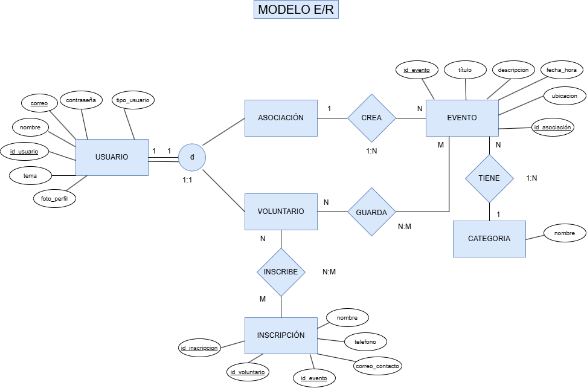
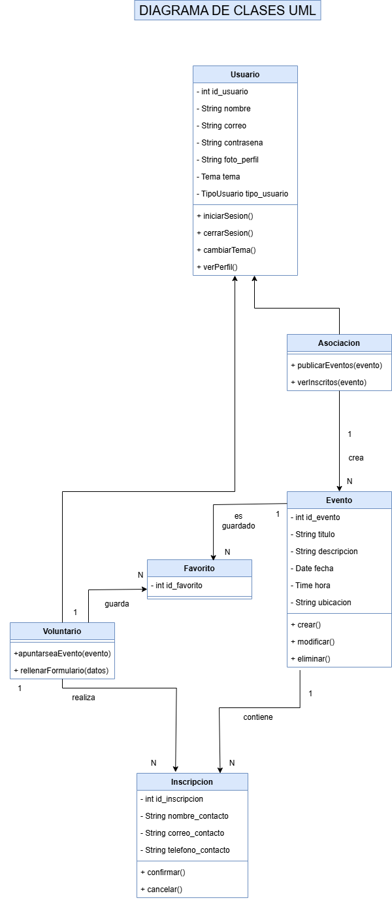
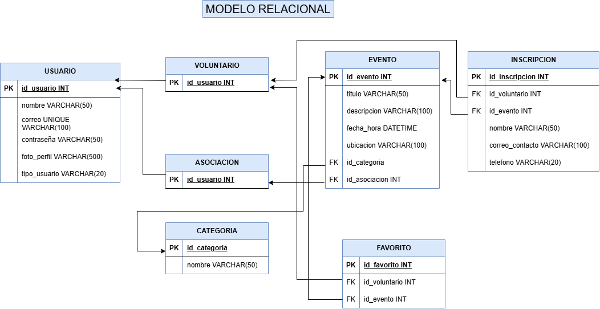

# Adiuvare — Backend

API REST del proyecto **Adiuvare**, una app que conecta asociaciones con voluntarios para gestionar eventos solidarios. Este repo contiene el backend (Spring Boot + JPA + MariaDB). El frontend (React) y la app Android (Kotlin) están en repos separados y consumen esta misma API.

---

## 1. Descripción

Adiuvare tiene dos roles:
- **Asociación**: crea, edita y elimina eventos.
- **Voluntario**: busca eventos, se inscribe y guarda favoritos.

El backend gestiona autenticación con JWT, registro de usuarios, CRUD de eventos y las relaciones N:M de favoritos e inscripciones.

---

## 2. Casos de uso



| # | Caso de uso | Actor |
| :---: | :--- | :--- |
| 1 | Registrarse | Usuario |
| 2 | Iniciar sesión | Usuario|
| 3 | Ver / buscar / filtrar eventos | Voluntario y Asociación |
| 4 | Inscribirse en un evento | Voluntario |
| 5 | Cancelar inscripción | Voluntario |
| 6 | Añadir a favoritos | Voluntario |
| 7 | Crear / editar / eliminar evento | Asociación |

---

## 3. Modelo de datos

### 3.1. Esquema E/R


La entidad `USUARIO` se especializa en `ASOCIACION` y `VOLUNTARIO`. Las asociaciones **crean** eventos (1:N) y los eventos se **clasifican** por categorías (1:N). Los voluntarios **se inscriben** y **guardan favoritos** en eventos (ambas N:M).

### 3.2. UML


Herencia con `Usuario` como clase base. Las relaciones N:M se convierten en clases asociativas (`Inscripcion`, `Favorito`).

### 3.3. Relacional


Estrategia **JOINED** para la herencia: `usuario` guarda los campos comunes y `asociacion`/`voluntario` solo el `id_usuario`.

### 3.4. Campos, claves y relaciones

| Entidad | Clave primaria | Campos propios | Relaciones |
| :--- | :--- | :--- | :--- |
| **usuario** | `id_usuario` | nombre, correo (UNIQUE), contrasena, foto_perfil, tipo_usuario, tema | 1:1 con asociacion/voluntario |
| **asociacion** | `id_usuario` (FK) | — | 1:N - evento |
| **voluntario** | `id_usuario` (FK) | — | N:M - evento (vía inscripcion y favorito) |
| **categoria** | `id_categoria` | nombre (UNIQUE) | 1:N - evento |
| **evento** | `id_evento` | titulo, descripcion, fecha_hora, ubicacion | FK - asociacion, FK - categoria; N:M con voluntario |
| **inscripcion** | `id_inscripcion` | nombre, correo_contacto | FK - voluntario, FK - evento. UNIQUE (voluntario, evento) |
| **favorito** | `id_favorito` | — | FK - voluntario, FK - evento. UNIQUE (voluntario, evento) |

**Relaciones N:M** (requisito del proyecto):
- **Voluntario - Evento (inscripción)**: resuelta con tabla `inscripcion` y `UNIQUE(id_voluntario, id_evento)`.
- **Voluntario - Evento (favorito)**: resuelta con tabla `favorito` y `UNIQUE(id_voluntario, id_evento)`.

---

## 4. ORM (JPA + Hibernate)

Cada entidad es una clase Java anotada con `@Entity` en `com.adiuvare.model`:

| Clase | Anotación clave |
| :--- | :--- |
| `Usuario` | `@Inheritance(strategy = JOINED)` |
| `Asociacion` / `Voluntario` | `@PrimaryKeyJoinColumn` |
| `Evento` | `@ManyToOne` - Asociacion y Categoria |
| `Inscripcion` / `Favorito` | `@ManyToOne` - Voluntario y Evento + `@UniqueConstraint` |

Repositorios JPA en `com.adiuvare.repository` (`UsuarioRepository`, `EventoRepository`, `FavoritoRepository`, `InscripcionRepository`, `CategoriaRepository`).

---

## 5. Tecnologías y requisitos

| | Versión |
| :--- | :--- |
| Java | 21 |
| Spring Boot | 4.1.2 |
| Hibernate | 7.4.13 |
| MariaDB | 10.6+ |
| jjwt | 0.11.5 |

**Requisitos**: JDK 21, Maven, MariaDB en `localhost:3306`.

---

## 6. Instalación y ejecución

```sql
CREATE DATABASE adiuvare_db;
```

Configura `application.properties`:
```properties
spring.datasource.url=jdbc:mariadb://localhost:3306/adiuvare_db?createDatabaseIfNotExist=true
spring.datasource.username=root
spring.datasource.password=tu_contraseña
spring.jpa.hibernate.ddl-auto=update
```

Arranca:
```bash
mvn spring-boot:run
```

Verifica: `curl http://localhost:8080/api/categorias` - devuelve JSON con categorías.

> Guía detallada con capturas: [Manual de instalación](../docs/manual-instalacion.pdf).

---

## 7. Endpoints principales

| Método | Endpoint | Descripción |
| :--- | :--- | :--- |
| POST | `/api/auth/register` | Registro |
| POST | `/api/auth/login` | Login (devuelve JWT) |
| GET/POST/PUT/DELETE | `/api/eventos` | CRUD de eventos |
| GET/POST | `/api/categorias` | Listar / crear categorías |
| GET/POST | `/api/favoritos` | Listar / toggle favorito |
| GET/POST/DELETE | `/api/inscripciones` | Listar / crear / eliminar inscripción |

---

## 8. Manuales

- [Manual de instalación](../docs/manual-instalacion.pdf)
- [Manual de usuario](../docs/manual-usuario.pdf)

---

## 9. Repos relacionados y gestión

- [Frontend React](https://github.com/Jvdith/adiuvare-app)
- [App Android Kotlin](https://github.com/Jvdith/adiuvare-android)
- [Sprints Backend](https://github.com/users/Jvdith/projects/2)

